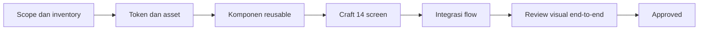
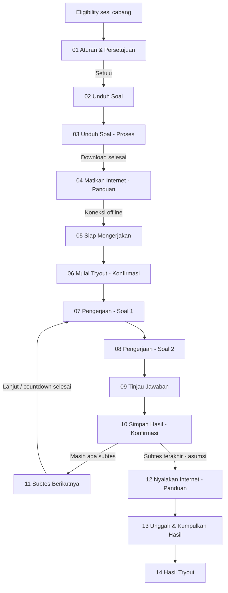

# Figma Craft Plan — Ruanguji TO Offline

Dokumen ini memetakan pekerjaan untuk menerjemahkan section Figma `15:7547` menjadi prototype yang dapat dijalankan, ditinjau, dan diiterasi sampai visualnya sesuai dengan desain.

## Aturan kerja

- Section Figma berisi 14 screen utama.
- Mock browser bar di setiap frame diabaikan. Implementasi dimulai dari navbar atau konten produk.
- Target utama setiap screen adalah viewport mobile `360 × 740`.
- Prototype mencakup visual dan simulasi behavior yang relevan.
- Stack prototype menggunakan React dengan komponen reusable.
- Figma dan `PROJECT_CONTEXT.md` adalah sumber utama; copy dan data dapat disesuaikan bila mendukung intent desain.
- Self-review menggunakan evidence. Asumsi yang toleran boleh digunakan dan harus dicatat; area yang masih kabur masuk `USER_ACTIONS.md`.
- Asset visual diambil dari Figma dan disimpan secara lokal agar tidak bergantung pada URL asset sementara.
- Komponen yang berulang dibuat reusable sebelum dipakai di banyak screen.
- Setiap screen melewati siklus `Planned → Crafting → Internal Review → Changes Requested → Approved`.
- `Internal Review` adalah handoff sementara, bukan item backlog aktif. Builder cukup mengirim evidence; planner yang melakukan review visual dan functional.
- Jika evidence sesuai, planner mengubah status menjadi `Approved`. Jika tidak sesuai, planner membuat catatan mismatch dan mengubah status menjadi `Changes Requested`.
- Screen dianggap `Approved` setelah struktur, visual, interaksi, dan screenshot review selesai.
- Perubahan di-commit per task. Merge ke `main` dilakukan per milestone stabil agar histori mudah ditelusuri.

## Alur pengerjaan



## Inventory dan task state

Tabel ini menyimpan inventory screen dan dependensi. Status `Internal Review` tidak perlu ditampilkan sebagai backlog atau dikerjakan ulang oleh user; status itu hanya menunggu review planner. Backlog aktif hanya berisi task `Planned`, `In Progress`, `Blocked`, atau `Changes Requested`.

| ID | Task | Dependensi | Output | Status |
| --- | --- | --- | --- | --- |
| CRAFT-000 | Kunci scope dan aturan visual | — | Aturan craft disepakati | Done |
| CRAFT-001 | Inventarisasi 14 screen dan node Figma | CRAFT-000 | Screen inventory | Done |
| CRAFT-002 | Petakan flow, state, dan transisi | CRAFT-001 | Flow/state map | Internal Review |
| CRAFT-003 | Ekstrak token visual | CRAFT-001 | Token warna, typography, spacing, radius, shadow | Internal Review |
| CRAFT-004 | Inventarisasi dan lokalkan asset | CRAFT-001 | Asset map dan file asset lokal | Approved |
| CRAFT-005 | Rancang komponen reusable | CRAFT-002, CRAFT-003, CRAFT-004 | Component map dan API props | Internal Review |
| CRAFT-006 | Siapkan app shell dan routing prototype React | CRAFT-002, CRAFT-005 | React shell, screen state, dan navigation model | Internal Review |
| CRAFT-007 | Kunci state contract dan test fixture | CRAFT-002, CRAFT-006 | State matrix, fixture path, dan acceptance criteria | Internal Review |
| CRAFT-101 | Craft screen 01 — Aturan & Persetujuan | CRAFT-006 | Frame `15:9085` | Internal Review |
| CRAFT-102 | Craft screen 02 — Unduh Soal | CRAFT-006 | Frame `6:419` | Internal Review |
| CRAFT-103 | Craft screen 03 — Unduh Soal — Proses | CRAFT-006 | Frame `7:978` | Internal Review |
| CRAFT-104 | Craft screen 04 — Matikan Internet — Panduan | CRAFT-006 | Frame `8:1203` | Internal Review |
| CRAFT-105 | Craft screen 05 — Siap Mengerjakan | CRAFT-006 | Frame `8:1484` | Internal Review |
| CRAFT-106 | Craft screen 06 — Mulai Tryout — Konfirmasi | CRAFT-006 | Frame `37:10312` | Internal Review |
| CRAFT-107 | Craft screen 07 — Pengerjaan — Soal 1 | CRAFT-006 | Frame `8:2053` | Internal Review |
| CRAFT-108 | Craft screen 08 — Pengerjaan — Soal 2 | CRAFT-006 | Frame `8:2154` | Internal Review |
| CRAFT-109 | Craft screen 09 — Tinjau Jawaban | CRAFT-006 | Frame `13:3198` | Internal Review |
| CRAFT-110 | Craft screen 10 — Simpan Hasil — Konfirmasi | CRAFT-006 | Frame `15:7308` | Internal Review |
| CRAFT-111 | Craft screen 11 — Subtes Berikutnya | CRAFT-006 | Frame `8:2032` | Internal Review |
| CRAFT-112 | Craft screen 12 — Nyalakan Internet — Panduan | CRAFT-006 | Frame `15:9660` | Internal Review |
| CRAFT-113 | Craft screen 13 — Unggah & Kumpulkan Hasil | CRAFT-006 | Frame `15:9810` | Internal Review |
| CRAFT-114 | Craft screen 14 — Hasil Tryout | CRAFT-006 | Frame `11:2632` | Approved |
| CRAFT-201 | Integrasikan transisi antar-screen | CRAFT-101–114 | Flow dapat dijalankan dari awal sampai akhir | Internal Review |
| CRAFT-202 | Implementasikan state offline dan network enforcement | CRAFT-002, CRAFT-201 | State online, offline, warning, dan terminasi | Internal Review |
| CRAFT-203 | Implementasikan timer, autosave, submit, dan pending upload | CRAFT-201, CRAFT-202 | Perilaku tryout sesuai baseline MVP | Internal Review |
| CRAFT-204 | Review responsive dan overflow mobile | CRAFT-101–114 | Semua screen stabil pada viewport target | Internal Review |
| CRAFT-205 | Review visual end-to-end | CRAFT-201–204 | Daftar mismatch dan hasil iterasi terakhir | Internal Review |
| CRAFT-206 | Final cleanup dan handoff | CRAFT-205 | Prototype siap diteruskan ke development | Internal Review |
| CRAFT-208 | Jalankan automated smoke test untuk state dan flow | CRAFT-007, CRAFT-201–203 | Test matrix lulus dan evidence tersimpan | Planned |
| CRAFT-209 | Visual regression per state, bukan hanya per screen | CRAFT-007, CRAFT-204 | Screenshot state matrix dan daftar mismatch | Internal Review |
| CRAFT-210 | Tutup defect dan lakukan regression terakhir | CRAFT-208, CRAFT-209 | Semua defect closed atau dicatat sebagai residual risk | Planned |
| CRAFT-213 | Audit loophole anti-internet dan integritas attempt | CRAFT-002, CRAFT-007 | Threat model, severity, dan mitigation backlog | Internal Review |
| CRAFT-214 | Finalisasi boundary enforcement attempt aktif | CRAFT-213 | Policy screen 07–11 dan boundary upload screen 12–13 | Internal Review |
| CRAFT-215 | Uji abuse case dan recovery attempt | CRAFT-213, CRAFT-214 | Abuse-case matrix dan evidence | Planned |
| CRAFT-216 | State-driven screen 04 — Persiapan Offline | CRAFT-202, CRAFT-209 | Step count, checklist, floating CTA, dan visual mengikuti network state | Internal Review |
| CRAFT-217 | Audit visual screen 09 — Tinjau Jawaban | CRAFT-109, CRAFT-204 | Review screen bersih pada posisi scroll 0 dan sesuai frame Figma | Internal Review |
| CRAFT-218 | Audit visual screen 14 — Hasil Tryout | CRAFT-114, CRAFT-204 | Result screen full-bleed, tidak terpotong, dan sesuai frame Figma | Approved |
| CRAFT-219 | Rebuild screen 06 sebagai native bottom drawer | CRAFT-106, CRAFT-204 | Drawer konfirmasi native, bukan screenshot full-screen | Internal Review |
| CRAFT-220 | Rebuild ikon navigator soal screen 07–08 | CRAFT-107, CRAFT-108 | Ikon grid/list sesuai Figma, bukan karakter teks | Internal Review |
| CRAFT-221 | Kunci visual state screen 07 vs 08 | CRAFT-107, CRAFT-108, CRAFT-220 | State question navigator konsisten tanpa layout drift | Internal Review |
| CRAFT-222 | Audit framing dan state screen 12 | CRAFT-112, CRAFT-204, CRAFT-216 | Screen upload preparation stabil dari scroll 0 dan sesuai Figma | Internal Review |
| CRAFT-223 | Perbaiki delivery asset Figma | CRAFT-004, CRAFT-006 | Semua asset lokal tersedia di dev dan production preview | Approved |
| CRAFT-224 | Wire touchpoint navigator soal ke screen 09 | CRAFT-220, CRAFT-221, CRAFT-109 | Ikon grid pada screen 07/08 membuka screen 09 dengan state attempt tetap utuh | Internal Review |
| CRAFT-225 | Audit visual screen 11 — Subtes Berikutnya | CRAFT-111, CRAFT-204, CRAFT-223 | Screen 11 mengikuti frame Figma `8:2032` pada viewport 360 × 740 | Internal Review |

#### Evidence terbaru

- `npm run build` berhasil pada 10 Oktober 2026.
- Flow yang diuji pada `http://localhost:3000/`: mulai attempt → koneksi online terdeteksi → input dan navigasi terkunci → kembali offline → timer lanjut → online selama 25 detik → attempt terminated → `pending_sync` → upload berhasil → hasil tryout.
- Kontrol `Open network simulator` tersedia di header screen pengerjaan karena navbar utama disembunyikan pada frame Figma tersebut.
- Audit E2E menemukan network enforcement belum mencakup seluruh attempt: screen 09–11 masih dapat dipakai saat Online. Screen 05–06 dicatat sebagai pre-check UX terpisah, bukan boundary nudge anti-cheat. Detail threat model dicatat di `SECURITY_AUDIT.md`.
- Defect `screen 12 tetap 0/2 saat simulator Online` ditemukan melalui screenshot review dan diperbaiki dengan state-driven rendering.
- Verifikasi tambahan: screen 12 Online menampilkan `1/2` dan CTA aktif; screen 12 Offline menampilkan `0/2` dan CTA disabled.
- Defect `screen 04 tetap 1/2 saat simulator Offline` diperbaiki dengan state-driven step count, checklist, success styling, dan CTA.
- Browser smoke evidence: screen 08 Online menampilkan overlay `25 detik` dan disabled controls; screen 09 Online menampilkan overlay dan disabled `Kembali ke Soal`/`Simpan Hasil` controls.
- Upload recovery now has visible `uploading`, `failed`, `pending_sync`, and `Coba Lagi` states before screen 14 is reachable.
- User visual feedback for screen 04: CTA `Lanjutkan` was converted to a floating action with no full-width sticky panel. Tracked in `CRAFT-216`.
- User visual feedback for screen 06: the screenshot-backed modal was replaced with a semantic native bottom drawer and a localized warning illustration. Tracked in `CRAFT-219`.
- User visual feedback for screens 07–08: the text glyph `▦` was replaced with a `LayoutGrid` control with an accessible label and disabled state. Tracked in `CRAFT-220`.
- User visual feedback for screens 07–08: the two references intentionally differ by question state. Track state parity separately from browser/capture offset in `CRAFT-221`.
- User visual feedback for screen 12: navbar/logo appears cropped and the upload-preparation card sits high against the hero. The screenshot may be scrolled, so builder must verify from scroll 0 before changing geometry. Tracked in `CRAFT-222`.
- User visual feedback: screen 01 showed broken images for exam art, question-count icon, and clock icon. The supported localhost runtime now serves the tracked `public/assets/figma/` path correctly; verified in clean reload and all screen smoke checks. Tracked in `CRAFT-223`.
- User flow feedback: ikon grid pada screen 07 dan 08 adalah touchpoint menuju screen 09 `Tinjau Jawaban`. Kontrol visualnya sudah tersedia, tetapi handler navigasinya belum tersambung. Tracked in `CRAFT-224`.

#### CRAFT-224 — Question navigator menuju screen 09

- Screens: `CRAFT-107` dan `CRAFT-108` → `CRAFT-109` / nodes `8:2053`, `8:2154`, `13:3198`
- Status: `Internal Review`
- Owner: builder

Acceptance criteria:

- [x] Klik ikon grid dari screen 07 membuka screen 09 `Tinjau Jawaban`.
- [x] Klik ikon grid dari screen 08 membuka screen 09 `Tinjau Jawaban`.
- [x] Transisi menetapkan `attemptStatus = reviewing` dan mempertahankan jawaban, ragu-ragu, serta timer.
- [x] Saat attempt terkunci atau terminated, ikon tidak dapat membuka screen 09.
- [x] Tombol `Kembali ke Soal` dari screen 09 memiliki route yang ditentukan dan tidak selalu memaksa kembali ke screen 07 bila entry point berasal dari screen 08.
- [x] Browser smoke evidence mencakup kedua entry point serta enabled dan disabled state pada viewport 360 × 740.
- [x] `npm run build` dan `git diff --check` lulus.

Evidence: screen 07 grid → screen 09 → `Kembali ke Soal` returns to screen 07; screen 08 grid → screen 09 → `Kembali ke Soal` returns to screen 08; online mode exposes a disabled question navigator and locks the attempt controls.

#### CRAFT-225 — Screen 11 visual parity

- Screen: `CRAFT-111` / node `8:2032` (`11 · Subtes Berikutnya`)
- Figma frame: `360 × 740`
- Status: `Internal Review`
- Owner: builder

Temuan audit terhadap source Figma:

- Header Figma memiliki frame `y=0..300`; tombol back berada di `x=8, y=16, 32×32` dan title berada di `x=56, y=16, 248×48`. Prototype perlu mengikuti posisi ini, termasuk line-height title dua baris.
- Figma menempatkan summary pada `x=12, y=82, 336×67`, lalu card `Tes selanjutnya` pada `x=12, y=165, 336×176`. Prototype saat ini menempatkan card kedua pada `top: 140px`, sehingga jarak 16 px dari summary hilang dan kedua card terlihat terlalu rapat/bertumpuk.
- Header Figma memakai pattern asset header, bukan hanya gradient dan mask yang dirender terpisah. Pattern dekoratif bagian atas dan sisi kanan perlu tetap terlihat seperti frame `8:2033`.
- Figma memakai `asset_ruanguji_backgroundpage` pada `x=0, y=604, 360×136` di area countdown dan CTA. Prototype saat ini masih memakai background datar dan shadow wrapper, sehingga area bawah belum mengikuti source.
- Footer Figma memiliki countdown pada `y=647`, progress track pada `y=672` dengan fill `84 px`, dan sticky button wrapper pada `y=676..740`. Posisi ketiganya perlu dikunci terhadap frame, bukan dihitung dari offset yang dapat bergeser.

Acceptance criteria:

- [x] Summary dan card berikutnya memiliki posisi `y=82` dan `y=165`, dengan jarak 16 px dan tanpa overlap.
- [x] Card `Tes selanjutnya` berukuran `336×176` dan struktur internalnya mengikuti instance Figma `8:2046`.
- [x] Header title dan tombol back mengikuti bounds Figma; tidak ada vertical drift pada viewport `360×740`.
- [x] Pattern header dan background bawah memakai asset lokal yang sesuai dari Figma, termasuk `result-bg.svg` untuk area `y=604..740`.
- [x] Countdown, progress track/fill, sticky wrapper, dan CTA berada pada bounds `y=647`, `y=672`, dan `y=676` sesuai frame.
- [x] State disabled saat attempt terkunci tetap terlihat sesuai desain dan tidak menggeser layout.
- [x] Browser evidence screenshot full viewport screen 11 tersedia pada `360×740`; `npm run build` dan `git diff --check` lulus.

Evidence: screen 11 was inspected at `http://localhost:3000/` in offline and locked online states. The offline capture shows the two-line header, 16 px card gap, local header/bottom patterns, and fixed footer coordinates; the online capture shows the disabled back and CTA state without layout shift.

#### CRAFT-206 — Final cleanup dan handoff

- Scope: prototype handoff after the visual parity and interaction audit
- Status: `Internal Review`

Checklist:

- [x] Vite development and preview configuration use port `3000` by default.
- [x] All 44 Figma assets are tracked under `public/assets/figma/` and included in the production build.
- [x] Question navigator transitions and screen 11 geometry are implemented and committed in `bce367b`.
- [x] `npm run build` passes.
- [x] `git diff --check` passes.
- [x] Browser review remains available at `http://localhost:3000/` with the 360 × 740 target frame.

Handoff note: existing documentation and evidence edits remain in the working tree for planner review; no unrelated user files were reset or discarded.

#### REVIEW-011 — Figma asset delivery and screen 12 framing

- Tasks: `CRAFT-004`, `CRAFT-222`, `CRAFT-223`
- Viewport: `360 × 740`, production preview at `http://127.0.0.1:4173/`
- Status: `Approved`
- Evidence: `evidence/CRAFT-223-screen01.png`, `evidence/CRAFT-222-screen12-online.png`, `evidence/CRAFT-222-screen12-offline.png`, `evidence/CRAFT-222-screen13-online.png`

Results:

- Selected `public/assets/figma/` as the static delivery directory; product code consistently requests `/assets/figma/*`. All 44 local Figma assets are present in the production `dist/assets/figma/` output and are served with HTTP 200 by Vite preview.
- Checked `naturalWidth > 0` for every rendered image on all 14 screens in a fresh Chrome profile. No broken images were found. CSS hero and review mask URLs also resolve from the production preview.
- Screen 12 capture from scroll top shows the navbar fully within the frame, full-bleed hero, and the upload card at the 12 px inset. The preparation content is 793 px tall inside a 680 px view, so it now scrolls internally while the CTA remains at the bottom of the 360 × 740 frame.
- Screen 12 state capture: Online renders `1/2`, green connection checklist, and enabled `Lanjutkan`; Offline renders `0/2` and disabled CTA.
- Screen 13 comparison remains at the bottom of the frame with its short upload card, enabled only while Online. Upload card and CTA state remain distinct from screen 12.
- Evidence was captured from the production build at `scrollTop = 0`; guide content was also inspected at the lower scroll position. No source-node Figma connection was available in this session, so exact pixel-by-pixel coordinates remain for planner visual review.
- Verification: `npm run build`, `git diff --check`, production preview asset HTTP checks, and 14-screen Chrome image sweep passed.
- Additional live verification: clean reload at `http://localhost:4173/` rendered screen 01 assets, and all 14 screen image checks returned `complete && naturalWidth > 0`.
- Runtime note: use `http://localhost:4173/` for the Vite prototype. The `file://` tab is not a supported runtime and can make root asset URLs appear broken.

#### REVIEW-012 — Screen 04, 06, and question state follow-up

- Tasks: `CRAFT-216`, `CRAFT-219`, `CRAFT-220`, `CRAFT-221`
- Viewport: `360 × 740`, production preview at `http://127.0.0.1:4173/`
- Status: `Internal Review`
- Evidence: `evidence/CRAFT-216-screen04-online.png`, `evidence/CRAFT-216-screen04-offline.png`, `evidence/CRAFT-216-screen04-online-scroll-bottom.png`, `evidence/CRAFT-219-screen06.png`, `evidence/CRAFT-221-screen07.png`, `evidence/CRAFT-221-screen07-pagination.png`, `evidence/CRAFT-221-screen07-online-locked.png`, `evidence/CRAFT-221-screen08.png`, `evidence/CRAFT-221-screen08-pagination.png`, `evidence/CRAFT-221-screen08-online-locked.png`

Results:

- Screen 04 CTA floats at x=24, y=672, width=312 px, with a 24 px bottom margin. Online is disabled; Offline is enabled. Scrolling to the bottom keeps the CTA in place and brings the final guide copy above it.
- Screen 06 uses a semantic dialog and separate illustration asset. Close, `Kembali`, and `Kerjakan Sekarang` were each activated with Enter and reached their correct screens.
- Screen 07 and 08 share identical geometry for header, pagination, instruction, passage, and sticky navigation. Question index, answered/current states, and offline label follow their respective fixture. Online mode shows the enforcement overlay and disables controls on both screens.
- Planner pixel comparison against nodes `8:1203`, `37:10312`, `8:2053`, and `8:2154` remains pending because the Figma design-context tool is unavailable in this builder session.
- Verification: `npm run build` and `git diff --check` passed.

#### REVIEW-010 — Figma asset delivery regression

- Scope: all screens using `/assets/figma/*`, initially observed on screen 01
- Evidence: screenshot user `Screenshot 2026-10-10 at 7.24.24 AM.png`
- Status: `Internal Review`

Temuan:

- [x] `book-pencil.svg`, `question-count.svg`, dan `clock.png` tampil utuh di exam card pada clean production preview.
- [x] Seluruh 44 asset tersedia di `dist/assets/figma/` setelah build.
- [x] Runtime memakai satu strategi static public path: `/assets/figma/...` dari `public/assets/figma/`.
- [x] Sweep 14 screen tidak menemukan image dengan `naturalWidth === 0`.

Task untuk builder:

- [x] Pilih strategi static public path yang konsisten dengan URL `/assets/figma/...`.
- [x] Pastikan semua 44 asset Figma masuk ke hasil build dan tersedia melalui production preview.
- [x] Periksa `naturalWidth > 0` pada seluruh gambar di 14 screen dan cek URL CSS mask/background terhadap preview.
- [x] Uji direct-open pada clean Chrome profile dan pindah screen melalui fixture tanpa cache tab lama.
- [x] Simpan screenshot screen 01 dan screen 12/13, lalu jalankan `npm run build` dan `git diff --check`.

Acceptance criteria:

- [x] Tidak ada broken image icon pada seluruh 14 screen.
- [x] Asset exam art, question count, clock, header, alert, guide, upload, review, dan result tampil dari local source.
- [x] `dist/` dan preview production memuat semua asset yang dirujuk.
- [x] Verifikasi lulus pada clean browser session.

#### REVIEW-009 — Screen 14 re-review

- Screen: `CRAFT-114` / `CRAFT-218` / node `11:2632`
- Evidence: live browser capture at `http://localhost:4173/`, viewport `360 × 740`
- Status: `Approved`

Hasil review:

- [x] Navbar dan hero tampil utuh tanpa clipping.
- [x] Profile card berada di posisi yang sesuai dan tidak menutupi title hero.
- [x] Waiting card, illustration, heading, dan tanggal tidak overflow.
- [x] Summary card menampilkan tiga metrik dan waktu pengerjaan dengan alignment konsisten.
- [x] Sticky CTA berada di bawah tanpa menutup summary content.
- [x] Tidak terlihat overlap, horizontal overflow, atau band kosong yang tidak diharapkan.
- [x] `npm run build` berhasil.
- [x] `git diff --check` berhasil.
- Review evidence after the parity pass: screen 06 drawer, screen 07/08 navigator states, screen 09 clean top frame, screen 12 online/offline framing, and screen 14 full-bleed result were inspected in the local browser at `360 × 740`.

#### REVIEW-002 — Screen 09 visual parity

- Screen: `CRAFT-109` / node `13:3198`
- Evidence: screenshot user `Screenshot 2026-10-10 at 6.27.35 AM.png`
- Target viewport: `360 × 740`, posisi scroll `0`
- Status: `Internal Review`

Temuan yang terlihat:

- [ ] Capture tidak dimulai dari top-level viewport yang bersih: ada elemen turquoise terpotong di bagian paling atas dan band putih/abu-abu sebelum hero. Builder perlu memastikan screen tidak mewarisi scroll offset, transform, atau tinggi container dari screen sebelumnya.
- [ ] Hero, judul, alert, dan card review perlu diverifikasi ulang terhadap koordinat frame Figma; screenshot saat ini hanya menampilkan sebagian screen sehingga tidak membuktikan posisi sticky action, subtitle, dan review groups.
- [ ] Alert merah terlihat terlalu dominan terhadap card peach: cek kembali tinggi, padding, radius, border, dan hubungan jarak alert ke card detail berdasarkan frame `13:3198`.
- [ ] Judul alert dan copy kedua harus tetap berada dalam batas inner alert pada lebar `360px`; jangan mengandalkan `white-space: nowrap` bila menyebabkan clipping pada device atau zoom berbeda.
- [ ] Isi card detail di bawah alert perlu diuji sampai bagian metrik, timer, info banner, subtitle, dan group soal; screenshot parsial belum cukup untuk menyatakan screen pixel-perfect.

Task untuk builder:

- [ ] Render screen 09 pada fresh load dan setelah navigasi dari screen 08, lalu set `scrollTop = 0` sebelum capture.
- [ ] Bandingkan screenshot dengan node Figma `13:3198` pada viewport `360 × 740`; catat koordinat top/left/width/height untuk hero, title, outer card, alert, detail card, sticky action, subtitle, dan review groups.
- [ ] Hapus sumber offset yang tidak berasal dari Figma. Jangan mengubah layout screen 10 modal sebagai kompensasi untuk masalah screen 09.
- [ ] Buat evidence screenshot full viewport untuk state normal dan state setelah memilih `Simpan Hasil`.
- [ ] Jalankan `npm run build` dan `git diff --check` setelah revisi.

Acceptance criteria:

- [ ] Tidak ada elemen terpotong atau band kosong yang tidak ada di Figma pada top viewport.
- [ ] Screen 09 tetap stabil saat dibuka langsung dari menu maupun melalui transisi screen 08 → 09.
- [ ] Semua elemen utama screen 09 terlihat dan tidak tertutup sticky action pada viewport target.
- [ ] Screenshot evidence full viewport tersedia untuk review planner sebelum status diputuskan `Approved` atau `Changes Requested`.

#### REVIEW-003 — Screen 14 visual parity

- Screen: `CRAFT-114` / node `11:2632`
- Evidence: screenshot user `Screenshot 2026-10-10 at 6.36.15 AM.png`
- Target viewport: `360 × 740`, posisi scroll `0`
- Status: `Approved` after `REVIEW-009`

Temuan yang terlihat:

- [ ] Capture menunjukkan navbar/logo hanya sebagian di tepi atas. Verifikasi apakah ini scroll offset/cropping saat capture atau layout screen; hasil akhir harus punya top viewport konsisten dan tidak memotong navbar maupun hero.
- [ ] Latar biru hero terlihat inset dari tepi kiri/kanan area aplikasi, sementara frame result tampak dimaksudkan sebagai bidang full-bleed. Cocokkan batas hero dan background dengan node Figma `11:2632`; jangan menebak berdasarkan crop screenshot saja.
- [ ] Profile card tampak menumpuk di batas bawah hero dengan overlap yang perlu dicocokkan terhadap frame sumber, termasuk x/y, lebar, tinggi, radius, dan shadow.
- [ ] Evidence berhenti di bagian awal card hasil; waiting illustration, rangkuman skor, waktu pengerjaan, serta sticky CTA tidak terlihat. Full-screen review diperlukan sebelum screen dapat dinyatakan rapi.
- [ ] Periksa konsistensi lebar app shell, padding horizontal, dan tinggi scroll container; screenshot harus diambil dari awal halaman pada viewport `360 × 740` tanpa browser mock.

Task untuk builder:

- [ ] Buka screen 14 dari menu dan melalui transisi upload berhasil, lalu reset semua scroll container ke posisi `0`.
- [ ] Bandingkan terhadap node Figma `11:2632`; catat koordinat hero/background, title, profile card, waiting card, summary, dan sticky CTA.
- [ ] Perbaiki inset/background bleed dan profile overlap hanya berdasarkan ukuran/relasi yang terverifikasi pada frame Figma.
- [ ] Capture full viewport dari top dan satu capture lanjutan yang memperlihatkan summary serta CTA; pastikan tidak ada konten tertutup atau terpotong.
- [ ] Jalankan `npm run build` dan `git diff --check` setelah revisi.

Acceptance criteria:

- [ ] Header/hero tidak terpotong dan background mengikuti lebar frame Figma.
- [ ] Profile card dan result content punya posisi serta overlap yang sama dengan frame sumber.
- [ ] Waiting state, rangkuman, waktu pengerjaan, dan CTA terlihat/terjangkau tanpa overlap pada target viewport.
- [ ] Evidence full viewport dari screen direct-open dan flow upload tersedia untuk review planner sebelum status diputuskan `Approved` atau `Changes Requested`.

#### REVIEW-004 — Screen 04 floating CTA

- Screen: `CRAFT-104` / `CRAFT-216` / node `8:1203`
- Evidence: screenshot user `Screenshot 2026-10-10 at 6.37.13 AM.png`
- Target viewport: `360 × 740`
- Status: `Internal Review`

Temuan:

- [x] CTA `Lanjutkan` tampil sebagai tombol floating dengan margin dari sisi viewport dan tanpa panel selebar frame.
- [x] Online tetap disabled dan offline enabled; kedua state terlihat di posisi yang sama.
- [x] Isi panduan terakhir dapat dicapai dengan scroll dan tidak tertutup CTA.

Task untuk builder:

- [x] Wrapper memakai tombol floating berukuran 312 px dengan inset horizontal 24 px dan jarak bawah 24 px pada viewport target.
- [x] Validasi posisi pada scroll `0` dan scroll ke bawah: CTA tetap pada viewport sementara teks panduan terakhir dapat dicapai.
- [x] Online disabled dan offline enabled; radius, shadow, dan kontras diperiksa.
- [x] Capture kedua state serta build dan whitespace check berhasil.

Acceptance criteria:

- [x] Tombol terlihat floating dengan margin 24 px, bukan sebagai panel putih selebar viewport.
- [x] CTA tidak menutup copy panduan terakhir dan dapat ditekan pada state offline.
- [x] State disabled/online dan enabled/offline sesuai behavior yang disepakati.
- [x] Screenshot kedua state tersedia untuk review planner.

#### REVIEW-005 — Screen 06 native bottom drawer

- Screen: `CRAFT-106` / `CRAFT-219` / node `37:10312`
- Evidence: screenshot user `Screenshot 2026-10-10 at 6.38.23 AM.png`
- Target viewport: `360 × 740`; mock browser dan elemen background overlay diabaikan
- Status: `Internal Review`

Temuan:

- [x] Screen 06 memakai struktur DOM native dan tidak lagi merender screenshot modal penuh.
- [x] Drawer berisi close control, ilustrasi warning terpisah, heading, copy, emphasis orange, dan dua CTA.
- [x] Backdrop adalah layer terpisah dari konten drawer.
- [x] Drawer stabil pada viewport target dan seluruh konten terlihat.

Task untuk builder:

- [x] `StartTryoutModal` menggunakan `start-modal-layer`, `start-modal-backdrop`, dan `start-modal-sheet`.
- [x] Drawer hanya memakai asset ilustrasi warning yang terpisah, bukan screenshot full-screen.
- [x] Seluruh label dan kontrol drawer dibangun sebagai elemen DOM yang semantic.
- [x] Close dan `Kembali` menuju screen 05; `Kerjakan Sekarang` memulai attempt dan masuk screen 07.
- [x] Close button punya accessible label; Enter mengaktifkan close, `Kembali`, dan `Kerjakan Sekarang` dalam browser.
- [x] Screenshot viewport clean tersedia; build dan `git diff --check` berhasil.

Acceptance criteria:

- [x] Tidak ada `` screenshot full-screen sebagai layout screen 06.
- [x] Drawer dan controls adalah DOM; backdrop layer terpisah.
- [x] Close, `Kembali`, dan `Kerjakan Sekarang` memiliki target terpisah dan interaksi click berfungsi.
- [x] Drawer tidak memiliki overflow atau menutup CTA.
- [x] Screenshot clean dan keyboard activation evidence tersedia untuk close dan kedua CTA.

#### REVIEW-006 — Screen 07–08 question navigator icon

- Screen: `CRAFT-107` dan `CRAFT-108` / nodes `8:2053` dan `8:2154`
- Evidence: screenshot user `Screenshot 2026-10-10 at 6.39.40 AM.png`
- Target viewport: `360 × 740`
- Status: `Internal Review`

Temuan:

- [x] Glyph `▦` diganti dengan icon component `LayoutGrid` dari icon library project.
- [x] Control punya ukuran box 32 × 32 px dan accessible label yang sama pada kedua screen.
- [x] Full viewport dan crop pagination tersedia untuk kedua screen.

Task untuk builder:

- [x] Gunakan `LayoutGrid` dari icon library yang sudah dipakai project.
- [x] Ukuran, stroke, alignment, dan hit target konsisten di screen 07 dan 08; pixel match menunggu planner review.
- [x] Uji screen 07/08 offline dan state online terkunci.
- [x] Capture full viewport dan crop pagination untuk kedua screen.
- [x] Jalankan `npm run build` dan `git diff --check`.

Acceptance criteria:

- [x] Ikon memakai vector icon, bukan glyph teks.
- [ ] Bentuk dan posisi exact terhadap node Figma menunggu planner review.
- [x] Control memiliki accessible label dan hit target 32 × 32 px.
- [x] Pagination card tidak clipping dan geometry kedua screen identik.

#### REVIEW-007 — Screen 07 vs 08 state parity

- Screens: `CRAFT-107` dan `CRAFT-108` / nodes `8:2053` dan `8:2154`
- Evidence: screenshots user `Screenshot 2026-10-10 at 6.40.34 AM.png` dan `Screenshot 2026-10-10 at 6.40.41 AM.png`
- Target viewport: `360 × 740`; mock browser/capture chrome diabaikan
- Status: `Internal Review`

Perbedaan yang memang berasal dari state:

- [x] Screen 07 menampilkan `Soal 1/4`; screen 08 menampilkan `Soal 2/4`.
- [x] Screen 07: nomor 1 current/orange, nomor 2–4 belum dijawab.
- [x] Screen 08: nomor 1 answered/blue, nomor 2 current/orange, nomor 3–4 belum dijawab.
- [x] Label koneksi berbeda sesuai fixture/state: `Mode Offline Aktif` dan `Mengerjakan Offline`.
- [x] Bounds timer dan elemen utama identik di kedua state.
- [x] Ikon grid, pagination, header, dan spacing identik di kedua state.

Perbedaan yang bukan target perubahan layout:

- [x] Kedua state dirender pada viewport bersih `360 × 740`, scroll `0`, dengan geometry identik.
- [ ] Pixel alignment terhadap screenshot sumber Figma menunggu planner visual review.

Task untuk builder:

- [ ] Jadikan screen 07 dan 08 dua fixture state dari komponen question screen yang sama.
- [ ] Pastikan transition 07 → 08 memperbarui question index, pagination status, label offline, dan content state tanpa mengubah geometry global.
- [ ] Capture side-by-side/full viewport untuk state 1 dan state 2, lalu tambahkan close-up pagination sebagai evidence.
- [ ] Uji state yang sama saat network enforcement disabled/locked agar disabled styling tidak menghapus perbedaan current vs answered.
- [ ] Jalankan `npm run build` dan `git diff --check`.

Acceptance criteria:

- [ ] Perbedaan 07/08 sesuai matrix state di atas.
- [ ] Tidak ada layout shift antar state selain konten/state yang memang berubah.
- [ ] Capture builder menggunakan viewport dan scroll position yang sama.
- [ ] Question navigator dan ikon grid konsisten serta tidak bergantung pada glyph font.

#### REVIEW-008 — Screen 12 framing and state parity

- Screen: `CRAFT-112` / `CRAFT-222` / node `15:9660`
- Evidence: screenshot user `Screenshot 2026-10-10 at 6.43.42 AM.png`
- Target viewport: `360 × 740`, mock browser diabaikan
- Status: `Internal Review`

Temuan:

- [x] Dari `scrollTop = 0`, navbar/logo utuh; card berada pada inset 12 px dan hero full-bleed ke frame.
- [x] Header, progress ring, alert, checklist, divider, dan panduan membentuk satu alur vertikal yang dapat digulir.
- [x] Online menunjukkan `1/2`, koneksi success, upload belum selesai, dan CTA aktif. Offline menunjukkan `0/2` dan CTA disabled.
- [x] Screen 12 dan 13 mempertahankan panel, state, dan posisi CTA yang berbeda.
- [ ] Perbandingan koordinat exact terhadap source node `15:9660` menunggu planner visual review; Figma design-context tool tidak tersedia di sesi builder.

Task untuk builder:

- [x] Capture direct-open pada `scrollTop = 0`, viewport `360 × 740`, tanpa mock browser.
- [x] Audit framing navbar, screen content, hero, card, dan CTA; panduan dapat digulir.
- [ ] Bandingkan koordinat terhadap source node `15:9660` saat planner visual review.
- [x] Uji dan capture state Online (`1/2`), Offline (`0/2`), serta screen 13 sebagai pembanding.
- [x] Jalankan `npm run build` dan `git diff --check`.

Acceptance criteria:

- [x] Navbar/logo utuh pada capture scroll 0.
- [x] Hero full-bleed pada app frame dan card mengikuti inset 12 px; exact Figma coordinate match masih menunggu review planner.
- [x] Upload preparation card mempertahankan urutan vertikal dan panduan dapat digulir pada viewport target.
- [x] State online/offline mengubah progress, checklist, dan CTA secara konsisten tanpa merusak layout.
- [x] Evidence full viewport tersedia untuk screen 12 dan pembanding screen 13.

## Task fondasi

### CRAFT-000 — Kunci scope dan aturan visual

- [x] Konfirmasi section target: `15:7547`.
- [x] Konfirmasi mock browser bar diabaikan.
- [x] Konfirmasi target viewport `360 × 740`.
- [x] Konfirmasi visual harus mengikuti Figma dan menggunakan asset asli.
- [x] Konfirmasi komponen akan dipakai ulang di screen lain.

### CRAFT-001 — Inventarisasi screen

- [x] Catat 14 screen utama dan node Figma.
- [x] Kelompokkan screen menjadi persiapan, pengerjaan, pengumpulan, dan hasil.
- [ ] Catat state awal, state sukses, state gagal, dan state disabled setiap screen.
- [ ] Catat hubungan tombol utama antar-screen.

### CRAFT-002 — Flow, state, dan transisi

- [x] Buat peta transisi dari screen 01 sampai 14.
- [x] Catat kondisi yang membuat CTA aktif atau disabled.
- [x] Catat state koneksi pada screen pengerjaan dan pengumpulan.
- [x] Catat state timer, autosave, submit, retry, dan terminasi.
- [x] Tandai bagian yang berasal dari wireframe PM dan bagian yang hanya visual Figma.

#### Flow baseline

Flow berikut menjadi baseline implementasi. Transisi yang diberi label **asumsi** perlu dikonfirmasi saat review produk atau ketika screen terkait mulai dikerjakan.



#### Transisi per screen

| Screen | State masuk | CTA atau event utama | State keluar |
| --- | --- | --- | --- |
| 01 Aturan & Persetujuan | Sesi offline eligible, persetujuan belum dicentang | Checkbox aturan | CTA `Lanjutkan` aktif setelah checkbox dicentang; kembali ke entrypoint jika memilih `Kembali` |
| 02 Unduh Soal | Paket belum tersedia | Mulai download | Masuk ke screen 03 dengan status download berjalan |
| 03 Unduh Soal — Proses | Download berjalan | Progress berubah atau download selesai | Selesai → screen 04; gagal → retry atau error state **perlu dirinci** |
| 04 Matikan Internet — Panduan | Paket lengkap, koneksi masih online | Peserta mengikuti panduan perangkat | Koneksi offline dan checklist selesai → screen 05 |
| 05 Siap Mengerjakan | Paket lengkap, koneksi offline | `Lanjutkan` | Masuk ke screen 06 |
| 06 Mulai Tryout — Konfirmasi | Peserta siap mulai | Persetujuan aturan atau `Mulai Tryout` | Timer dimulai, attempt dikunci, masuk screen 07 |
| 07 Pengerjaan — Soal 1 | Timer berjalan, koneksi offline | Pilih jawaban, tandai ragu-ragu, navigasi | Jawaban tersimpan lokal; navigasi ke screen 08 atau soal lain |
| 08 Pengerjaan — Soal 2 | Timer berjalan, jawaban dapat berubah | Navigasi soal atau selesai mengerjakan | Masuk ke screen 09 untuk meninjau jawaban |
| 09 Tinjau Jawaban | Semua jawaban tersimpan lokal | Kembali ke soal atau `Simpan Hasil` | Kembali ke mode answering atau masuk screen 10 |
| 10 Simpan Hasil — Konfirmasi | Ringkasan jawaban siap disimpan | Konfirmasi simpan atau kembali | Simpan lokal; subtes berikutnya → screen 11, subtes terakhir → screen 12 **asumsi** |
| 11 Subtes Berikutnya | Subtes sebelumnya selesai | Countdown atau CTA lanjut | Mulai subtes berikutnya, kembali ke screen 07 dengan data subtes baru |
| 12 Nyalakan Internet — Panduan | Semua subtes selesai, jawaban tersimpan lokal | Peserta menyalakan koneksi | Koneksi online → screen 13 |
| 13 Unggah & Kumpulkan Hasil | Koneksi online terdeteksi | `Upload & Kumpulkan Tryout` | Upload berjalan → hasil menunggu atau selesai, masuk screen 14 |
| 14 Hasil Tryout | Upload selesai atau hasil masih diproses | Tunggu hasil atau buka pembahasan | State `waiting`, `available`, dan akses pembahasan **perlu dicocokkan dengan backend** |

#### State global

| Area | State yang diperlukan | Dampak UI |
| --- | --- | --- |
| Eligibility | `public`, `offline_branch_active`, `offline_branch_not_started` | Public tetap ke flow online; offline branch masuk flow ini; sesi belum aktif menampilkan status tunggu |
| Download | `idle`, `downloading`, `completed`, `failed` | Progress, CTA, retry, dan pesan error berubah sesuai status |
| Consent | `unchecked`, `checked` | CTA utama disabled atau enabled |
| Network | `online`, `offline`, `unknown` | Checklist dan upload gate berubah; overlay enforcement hanya aktif selama attempt |
| Attempt | `not_started`, `active`, `reviewing`, `locked`, `terminated` | Menentukan apakah soal, timer, dan navigasi dapat dipakai |
| Answer | `unanswered`, `answered`, `doubtful` | Nomor soal, pilihan jawaban, ringkasan, dan penanda ragu-ragu berubah |
| Timer | `running`, `paused_by_network`, `expired` | Timer berjalan, berhenti sementara, atau otomatis mengumpulkan |
| Network enforcement | `inactive`, `clear`, `warning_0_to_25s`, `terminated` | Enforcement aktif hanya selama attempt; input dikunci saat online dan attempt dihentikan setelah 25 detik sesuai baseline PM |
| Upload | `not_ready`, `ready`, `uploading`, `uploaded`, `failed`, `pending_sync` | CTA, progress, retry, dan status hasil berubah |
| Result | `waiting`, `available`, `error` | Menampilkan status pemrosesan atau CTA pembahasan |

#### State per fase

**Persiapan**

- Download hanya tersedia setelah eligibility sesi cabang valid.
- Screen 01 mengharuskan peserta mencentang persetujuan sebelum CTA aktif.
- Screen 04 menunggu koneksi berubah menjadi offline sebelum dapat lanjut.
- Jika koneksi tetap online pada pre-check, CTA mulai tetap disabled.

**Pengerjaan**

- Timer mulai saat attempt benar-benar dimulai di screen 06.
- Jawaban disimpan lokal setiap kali peserta memilih opsi atau berpindah soal.
- Peserta dapat menandai soal sebagai `doubtful`.
- Koneksi online memunculkan overlay, mengunci soal dan navigasi, serta menghentikan timer.
- Jika koneksi kembali offline dalam 25 detik, overlay ditutup dan timer dilanjutkan.
- Jika koneksi tetap online selama 25 detik, attempt menjadi `terminated` dan tidak dapat dilanjutkan.

Boundary enforcement: nudge anti-internet dimulai ketika attempt masuk screen pengerjaan dan berlaku sampai attempt disimpan atau terminated. Persiapan download tidak memakai nudge anti-cheat; persiapan upload memakai gate koneksi yang terpisah.

**Review dan simpan**

- Screen 09 memperlihatkan soal terjawab, dilewati, dan ragu-ragu.
- Peserta dapat kembali ke soal sebelum mengonfirmasi simpan.
- Screen 10 mengunci hasil lokal setelah konfirmasi.

**Pengumpulan**

- Screen 12 memandu peserta menyalakan koneksi.
- Screen 13 mengaktifkan CTA upload setelah online terdeteksi.
- Jawaban yang gagal dikirim masuk `pending_sync` dan dapat dicoba ulang.
- Screen 14 membedakan hasil yang masih menunggu dengan hasil yang sudah tersedia.

#### Keputusan yang masih terbuka

1. Apakah screen 10 menuju screen 11 untuk semua subtes kecuali subtes terakhir, lalu menuju screen 12 hanya setelah subtes terakhir?
2. Apakah countdown pada screen 11 dapat dibatalkan atau hanya dapat dilewati melalui CTA?
3. State error download dan upload yang perlu ditampilkan di prototype belum memiliki screen khusus di section ini.
4. Apakah hasil pada screen 14 langsung tersedia setelah upload atau selalu masuk state menunggu?
5. Apakah event `NETWORK_RECOVERED`, koneksi terdeteksi, dan terminasi harus terlihat di UI peserta atau hanya dikirim ke dashboard pengawas?
6. Apakah enforcement harus mencakup screen review, konfirmasi simpan, dan transisi subtes selama attempt belum final? Baseline planning saat ini menganggap iya.

### CRAFT-003 — Token visual

- [ ] Warna background, text, border, primary, warning, dan error.
- [ ] Font family, weight, size, line height, dan letter spacing.
- [ ] Spacing utama: page padding, card padding, gap, dan button padding.
- [ ] Radius card, alert, checkbox, dan button.
- [ ] Shadow card dan sticky action bar.
- [ ] Ukuran dan alignment icon.

### CRAFT-004 — Asset map

- [x] Download asset yang dipakai screen 01.
- [x] Kelompokkan asset berdasarkan komponen dan fungsi.
- [x] Pertahankan nama file lokal yang jelas dan konsisten dengan export Figma.
- [x] Catat section sumber dan node screen yang menggunakan registry.
- [x] Inventarisasi 44 asset lokal yang dipakai lintas screen 01–14.

#### Asset registry

Semua file di bawah bersumber dari section Figma `15:7547`. Salinan untuk delivery statis berada di `public/assets/figma/` dan tersedia saat build di `dist/assets/figma/`; runtime memakai URL `/assets/figma/<nama-file>`.

| Kelompok | Asset |
| --- | --- |
| Navbar dan profil | `ruangguru-logo.svg`, `navbar-more.svg`, `dropdown.svg`, `user-head.svg`, `user-body.svg`, `user-outer.svg`, `result-account.png` |
| Hero dan background | `header-left.svg`, `header-right.svg`, `header-mask.svg`, `result-bg.svg`, `result-header-bg.svg`, `review-background-mask.svg` |
| Exam dan download | `book-pencil.svg`, `book.svg`, `pencil.svg`, `test.svg`, `download.svg`, `question-count.svg`, `clock.png` |
| Checklist dan network | `checklist.svg`, `checklist-ready.svg`, `checklist-ready-banner.svg`, `checklist-success.svg`, `checklist-offline-complete.svg`, `wifi.svg`, `protected.svg`, `refresh.svg`, `warning.svg` |
| Review dan timer | `review-alert.svg`, `review-info.svg`, `review-info-blue.svg`, `review-pagination.svg`, `review-pagination-blue.svg`, `review-clock.png`, `divider.svg`, `alert-paper.svg`, `alert-paper-detail.svg`, `alert-badge.svg` |
| Panduan dan konfirmasi | `android-guide.svg`, `save-warning.png`, `start-tryout-modal.png`, `start-tryout-warning.png` |
| Hasil | `result-waiting.png` |

### CRAFT-005 — Komponen reusable

- [ ] `AppShell` dan mobile viewport wrapper.
- [ ] `Navbar`.
- [ ] `HeaderBackground`.
- [ ] `PreparationHeader` dengan step indicator.
- [ ] `ProgressChecklist` dan checklist item.
- [ ] `Card`.
- [ ] `Alert` atau `Notice`.
- [ ] `Button` primary, secondary, disabled, dan loading.
- [ ] `Checkbox`.
- [ ] `Chip` atau tab platform.
- [ ] `StickyActionBar`.
- [ ] `QuestionNavigator` dan `QuestionCard`.
- [ ] `Timer`.
- [ ] `NetworkOverlay`.
- [ ] `UploadProgress` dan `SyncStatus`.

### CRAFT-006 — App shell dan routing prototype

- [ ] Satu entry point untuk semua screen.
- [ ] Gunakan React sebagai stack prototype.
- [ ] State screen yang bisa dipilih saat review.
- [ ] Navigation antar-screen menggunakan CTA dari desain.
- [ ] Data demo terpusat agar isi screen konsisten.
- [ ] Komponen visual tidak bergantung pada screen tertentu.

## CRAFT-007 — State contract dan fixture path

- `network`: `online | offline`, controlled by the review menu and retained across screens.
- `attemptStatus`: `not_started | active | reviewing | locked | terminated`.
- Attempt boundary: screens 07–11. Online detection locks controls, pauses the timer, and starts a 25-second warning for every non-terminated attempt state.
- Recovery: returning offline clears the warning and resumes the timer; remaining online terminates the attempt and sets `syncStatus=pending_sync`.
- Upload boundary: screens 12–13 use a separate connection gate. Upload exposes `idle | uploading | failed`; failed uploads keep `pending_sync` and expose retry.
- Fixture path for browser review: screen 01 consent → screen 02 download → screen 03 progress → screen 04 offline gate → screen 05 readiness → screen 06 start → screens 07–11 attempt boundary → screen 12 online gate → screen 13 upload/retry → screen 14 result waiting.
- Acceptance evidence is tracked in `TEST_PLAN.md`; visual sign-off is performed by the planner after builder evidence is submitted.

### CRAFT-202/203/214/216 review notes

- Screen 08 and screen 09 were browser-smoke checked at 360 × 740 with Online mode; the warning overlay appeared and the visible controls were disabled.
- Screen 04 now renders `1/2` while Online and `2/2` while Offline, including checklist and CTA state.
- Screen 13 exposes upload failure and retry UI while preserving pending synchronization.

## Template task screen

Setiap task `CRAFT-101` sampai `CRAFT-114` menggunakan checklist ini.

### Implementasi

- [ ] Baca node Figma dan screenshot referensi.
- [ ] Catat struktur frame dan ukuran penting.
- [ ] Reuse token dan komponen yang sudah tersedia.
- [ ] Gunakan asset lokal dari Figma.
- [ ] Implementasikan konten, layout, dan state screen.
- [ ] Implementasikan CTA dan transisi yang relevan.
- [ ] Abaikan mock browser bar.

### Review

- [ ] Screenshot prototype pada viewport `360 × 740`.
- [ ] Bandingkan struktur dan posisi elemen dengan Figma.
- [ ] Review typography dan wrapping text.
- [ ] Review warna, border, radius, dan shadow.
- [ ] Review icon dan asset.
- [ ] Review state enabled, disabled, loading, dan error yang relevan.
- [ ] Catat mismatch dengan node dan lokasi yang spesifik.
- [ ] Iterasikan sampai reviewer memberi status `Approved`.

## Urutan craft yang disarankan

1. `CRAFT-101` — Aturan & Persetujuan sebagai pilot dan validasi komponen dasar.
2. `CRAFT-102` dan `CRAFT-103` — Download paket dan progress download.
3. `CRAFT-104` dan `CRAFT-105` — Panduan mematikan internet dan kesiapan offline.
4. `CRAFT-106` — Konfirmasi mulai tryout.
5. `CRAFT-107` dan `CRAFT-108` — Pengerjaan soal dan variasi state.
6. `CRAFT-109` dan `CRAFT-110` — Tinjau serta simpan hasil.
7. `CRAFT-111` — Transisi subtes.
8. `CRAFT-112` dan `CRAFT-113` — Menyalakan internet dan upload hasil.
9. `CRAFT-114` — Hasil tryout.
10. `CRAFT-201` sampai `CRAFT-206` — Integrasi, behavior offline, review, dan handoff.
11. `CRAFT-213` — Audit loophole dan integritas attempt.
12. `CRAFT-214` — Finalisasi boundary enforcement attempt aktif.
13. `CRAFT-215` — Abuse-case test dan recovery regression.
14. `CRAFT-216` — State-driven screen 04 dan regression persiapan offline.
15. `CRAFT-219` — Rebuild screen 06 sebagai native bottom drawer.
16. `CRAFT-220` — Rebuild ikon navigator soal screen 07–08.
17. `CRAFT-221` — Kunci visual state screen 07 vs 08.
18. `CRAFT-222` — Audit framing dan state screen 12.
19. `CRAFT-223` — Perbaiki delivery asset Figma.
20. `CRAFT-224` — Wire touchpoint navigator soal ke screen 09.
21. `CRAFT-225` — Audit visual screen 11 — Subtes Berikutnya.

## Format catatan review

```md
### REVIEW-001
- Screen: `CRAFT-101` / node `15:9085`
- Viewport: `360 × 740`
- Status: Changes Requested

Temuan:
- [ ] Card aturan terlalu tinggi 8 px.
- [ ] Logo navbar turun 2 px.
- [ ] State tombol belum mengikuti disabled state Figma.

Perbaikan berikutnya:
- [ ] Sesuaikan tinggi card.
- [ ] Sesuaikan alignment navbar.
- [ ] Perbaiki token disabled button.
```

### REVIEW-001 — Prototype pass

- Screens: `CRAFT-101`–`CRAFT-114`
- Viewport: `360 × 740`
- Status: Functional flow approved; visual parity with Figma is still pending.
- Evidence: local Vite preview inspected in browser at `http://localhost:3000/`.
- Verified: consent gating, download progress, offline/online CTA gating, question selection, doubtful state, review summary, save flow, upload flow, result state, and menu jump navigation.
- User review: flow confirmed okay.
- Fixed during review: review menu string IDs could render a blank screen; IDs are now converted to numeric `ScreenId` values before routing. The preparation screens were then aligned against their Figma references: removed the invented stepper, restored Indonesian copy, matched navbar alignment, rebuilt the disclaimer icon from local assets, matched the download card/progress/warning layout, added the long Android connection guide and completed 2/2 readiness state, used the exported Figma confirmation screenshot for screen 06 with functional click targets over the modal actions, and replaced the generic question card with the full-screen instruction, pagination, timer, offline pill, passage, and sticky navigation structure for screens 07–08.
- Continued visual craft: screens 09–14 now use Figma-matched layouts and local exported illustration assets. Screen 09 includes the review alert, progression metrics, timer, skipped/doubtful groups, and sticky actions. Screen 10 uses the Figma warning modal and keeps the confirmation transitions. Screen 11 is the subtest summary state; screens 12–13 are the offline upload preparation states; screen 14 shows the result pending state and score summary. All six screens were inspected in the local browser at 360 × 740 and are queued for internal planner review.
- Remaining: planner visual sign-off against the source Figma frames and product decisions for countdown cancellation, backend result timing, and upload error recovery.

## Definisi selesai

Craft plan selesai ketika:

- seluruh 14 screen memiliki implementasi dan status `Approved`;
- komponen reusable dipakai lintas screen;
- flow dari persiapan sampai hasil dapat dijalankan;
- state offline, timer, penyimpanan, submit, dan pending upload mengikuti baseline MVP;
- setiap mismatch visual terakhir sudah ditutup;
- prototype siap diteruskan ke tahap development.
