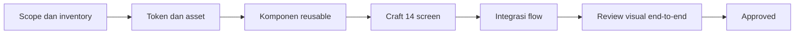
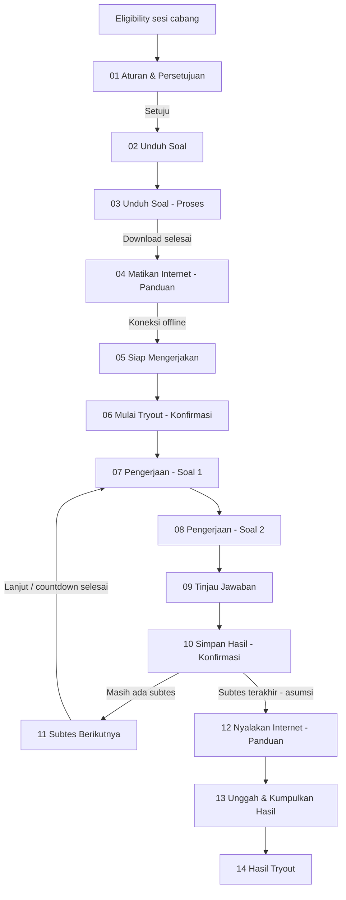

# Figma Craft Plan — Ruanguji TO Offline

Dokumen ini memetakan pekerjaan untuk menerjemahkan section Figma `15:7547` menjadi prototype yang dapat dijalankan, ditinjau, dan diiterasi sampai visualnya sesuai dengan desain.

## Aturan kerja

- Section Figma berisi 14 screen utama.
- Mock browser bar di setiap frame diabaikan. Implementasi dimulai dari navbar atau konten produk.
- Target utama setiap screen adalah viewport mobile `360 × 740`.
- Prototype mencakup visual dan simulasi behavior yang relevan.
- Stack prototype menggunakan React dengan komponen reusable.
- Figma dan `PROJECT_CONTEXT.md` adalah sumber utama; copy dan data dapat disesuaikan bila mendukung intent desain.
- Self-review menggunakan evidence. Asumsi yang toleran boleh digunakan dan harus dicatat; area yang masih kabur masuk `USER_ACTIONS.md`.
- Asset visual diambil dari Figma dan disimpan secara lokal agar tidak bergantung pada URL asset sementara.
- Komponen yang berulang dibuat reusable sebelum dipakai di banyak screen.
- Setiap screen melewati siklus `Planned → Crafting → Ready for Review → Changes Requested → Approved`.
- Screen dianggap `Approved` setelah struktur, visual, interaksi, dan screenshot review selesai.
- Perubahan di-commit per task. Merge ke `main` dilakukan per milestone stabil agar histori mudah ditelusuri.

## Alur pengerjaan



## Ringkasan task

| ID | Task | Dependensi | Output | Status |
| --- | --- | --- | --- | --- |
| CRAFT-000 | Kunci scope dan aturan visual | — | Aturan craft disepakati | Done |
| CRAFT-001 | Inventarisasi 14 screen dan node Figma | CRAFT-000 | Screen inventory | Done |
| CRAFT-002 | Petakan flow, state, dan transisi | CRAFT-001 | Flow/state map | Ready for Review |
| CRAFT-003 | Ekstrak token visual | CRAFT-001 | Token warna, typography, spacing, radius, shadow | Ready for Review |
| CRAFT-004 | Inventarisasi dan lokalkan asset | CRAFT-001 | Asset map dan file asset lokal | Ready for Review |
| CRAFT-005 | Rancang komponen reusable | CRAFT-002, CRAFT-003, CRAFT-004 | Component map dan API props | Ready for Review |
| CRAFT-006 | Siapkan app shell dan routing prototype React | CRAFT-002, CRAFT-005 | React shell, screen state, dan navigation model | Ready for Review |
| CRAFT-101 | Craft screen 01 — Aturan & Persetujuan | CRAFT-006 | Frame `15:9085` | Changes Requested |
| CRAFT-102 | Craft screen 02 — Unduh Soal | CRAFT-006 | Frame `6:419` | Changes Requested |
| CRAFT-103 | Craft screen 03 — Unduh Soal — Proses | CRAFT-006 | Frame `7:978` | Changes Requested |
| CRAFT-104 | Craft screen 04 — Matikan Internet — Panduan | CRAFT-006 | Frame `8:1203` | Changes Requested |
| CRAFT-105 | Craft screen 05 — Siap Mengerjakan | CRAFT-006 | Frame `8:1484` | Changes Requested |
| CRAFT-106 | Craft screen 06 — Mulai Tryout — Konfirmasi | CRAFT-006 | Frame `37:10312` | Changes Requested |
| CRAFT-107 | Craft screen 07 — Pengerjaan — Soal 1 | CRAFT-006 | Frame `8:2053` | Changes Requested |
| CRAFT-108 | Craft screen 08 — Pengerjaan — Soal 2 | CRAFT-006 | Frame `8:2154` | Changes Requested |
| CRAFT-109 | Craft screen 09 — Tinjau Jawaban | CRAFT-006 | Frame `13:3198` | Changes Requested |
| CRAFT-110 | Craft screen 10 — Simpan Hasil — Konfirmasi | CRAFT-006 | Frame `15:7308` | Changes Requested |
| CRAFT-111 | Craft screen 11 — Subtes Berikutnya | CRAFT-006 | Frame `8:2032` | Changes Requested |
| CRAFT-112 | Craft screen 12 — Nyalakan Internet — Panduan | CRAFT-006 | Frame `15:9660` | Changes Requested |
| CRAFT-113 | Craft screen 13 — Unggah & Kumpulkan Hasil | CRAFT-006 | Frame `15:9810` | Changes Requested |
| CRAFT-114 | Craft screen 14 — Hasil Tryout | CRAFT-006 | Frame `11:2632` | Changes Requested |
| CRAFT-201 | Integrasikan transisi antar-screen | CRAFT-101–114 | Flow dapat dijalankan dari awal sampai akhir | Planned |
| CRAFT-202 | Implementasikan state offline dan network enforcement | CRAFT-002, CRAFT-201 | State online, offline, warning, dan terminasi | Planned |
| CRAFT-203 | Implementasikan timer, autosave, submit, dan pending upload | CRAFT-201, CRAFT-202 | Perilaku tryout sesuai baseline MVP | Planned |
| CRAFT-204 | Review responsive dan overflow mobile | CRAFT-101–114 | Semua screen stabil pada viewport target | Planned |
| CRAFT-205 | Review visual end-to-end | CRAFT-201–204 | Daftar mismatch dan hasil iterasi terakhir | Planned |
| CRAFT-206 | Final cleanup dan handoff | CRAFT-205 | Prototype siap diteruskan ke development | Planned |

## Task fondasi

### CRAFT-000 — Kunci scope dan aturan visual

- [x] Konfirmasi section target: `15:7547`.
- [x] Konfirmasi mock browser bar diabaikan.
- [x] Konfirmasi target viewport `360 × 740`.
- [x] Konfirmasi visual harus mengikuti Figma dan menggunakan asset asli.
- [x] Konfirmasi komponen akan dipakai ulang di screen lain.

### CRAFT-001 — Inventarisasi screen

- [x] Catat 14 screen utama dan node Figma.
- [x] Kelompokkan screen menjadi persiapan, pengerjaan, pengumpulan, dan hasil.
- [ ] Catat state awal, state sukses, state gagal, dan state disabled setiap screen.
- [ ] Catat hubungan tombol utama antar-screen.

### CRAFT-002 — Flow, state, dan transisi

- [x] Buat peta transisi dari screen 01 sampai 14.
- [x] Catat kondisi yang membuat CTA aktif atau disabled.
- [x] Catat state koneksi pada screen pengerjaan dan pengumpulan.
- [x] Catat state timer, autosave, submit, retry, dan terminasi.
- [x] Tandai bagian yang berasal dari wireframe PM dan bagian yang hanya visual Figma.

#### Flow baseline

Flow berikut menjadi baseline implementasi. Transisi yang diberi label **asumsi** perlu dikonfirmasi saat review produk atau ketika screen terkait mulai dikerjakan.



#### Transisi per screen

| Screen | State masuk | CTA atau event utama | State keluar |
| --- | --- | --- | --- |
| 01 Aturan & Persetujuan | Sesi offline eligible, persetujuan belum dicentang | Checkbox aturan | CTA `Lanjutkan` aktif setelah checkbox dicentang; kembali ke entrypoint jika memilih `Kembali` |
| 02 Unduh Soal | Paket belum tersedia | Mulai download | Masuk ke screen 03 dengan status download berjalan |
| 03 Unduh Soal — Proses | Download berjalan | Progress berubah atau download selesai | Selesai → screen 04; gagal → retry atau error state **perlu dirinci** |
| 04 Matikan Internet — Panduan | Paket lengkap, koneksi masih online | Peserta mengikuti panduan perangkat | Koneksi offline dan checklist selesai → screen 05 |
| 05 Siap Mengerjakan | Paket lengkap, koneksi offline | `Lanjutkan` | Masuk ke screen 06 |
| 06 Mulai Tryout — Konfirmasi | Peserta siap mulai | Persetujuan aturan atau `Mulai Tryout` | Timer dimulai, attempt dikunci, masuk screen 07 |
| 07 Pengerjaan — Soal 1 | Timer berjalan, koneksi offline | Pilih jawaban, tandai ragu-ragu, navigasi | Jawaban tersimpan lokal; navigasi ke screen 08 atau soal lain |
| 08 Pengerjaan — Soal 2 | Timer berjalan, jawaban dapat berubah | Navigasi soal atau selesai mengerjakan | Masuk ke screen 09 untuk meninjau jawaban |
| 09 Tinjau Jawaban | Semua jawaban tersimpan lokal | Kembali ke soal atau `Simpan Hasil` | Kembali ke mode answering atau masuk screen 10 |
| 10 Simpan Hasil — Konfirmasi | Ringkasan jawaban siap disimpan | Konfirmasi simpan atau kembali | Simpan lokal; subtes berikutnya → screen 11, subtes terakhir → screen 12 **asumsi** |
| 11 Subtes Berikutnya | Subtes sebelumnya selesai | Countdown atau CTA lanjut | Mulai subtes berikutnya, kembali ke screen 07 dengan data subtes baru |
| 12 Nyalakan Internet — Panduan | Semua subtes selesai, jawaban tersimpan lokal | Peserta menyalakan koneksi | Koneksi online → screen 13 |
| 13 Unggah & Kumpulkan Hasil | Koneksi online terdeteksi | `Upload & Kumpulkan Tryout` | Upload berjalan → hasil menunggu atau selesai, masuk screen 14 |
| 14 Hasil Tryout | Upload selesai atau hasil masih diproses | Tunggu hasil atau buka pembahasan | State `waiting`, `available`, dan akses pembahasan **perlu dicocokkan dengan backend** |

#### State global

| Area | State yang diperlukan | Dampak UI |
| --- | --- | --- |
| Eligibility | `public`, `offline_branch_active`, `offline_branch_not_started` | Public tetap ke flow online; offline branch masuk flow ini; sesi belum aktif menampilkan status tunggu |
| Download | `idle`, `downloading`, `completed`, `failed` | Progress, CTA, retry, dan pesan error berubah sesuai status |
| Consent | `unchecked`, `checked` | CTA utama disabled atau enabled |
| Network | `online`, `offline`, `unknown` | Checklist, overlay, CTA upload, dan status sinkronisasi berubah |
| Attempt | `not_started`, `active`, `reviewing`, `locked`, `terminated` | Menentukan apakah soal, timer, dan navigasi dapat dipakai |
| Answer | `unanswered`, `answered`, `doubtful` | Nomor soal, pilihan jawaban, ringkasan, dan penanda ragu-ragu berubah |
| Timer | `running`, `paused_by_network`, `expired` | Timer berjalan, berhenti sementara, atau otomatis mengumpulkan |
| Network enforcement | `clear`, `warning_0_to_25s`, `terminated` | Input dikunci saat online; attempt dihentikan setelah 25 detik sesuai baseline PM |
| Upload | `not_ready`, `ready`, `uploading`, `uploaded`, `failed`, `pending_sync` | CTA, progress, retry, dan status hasil berubah |
| Result | `waiting`, `available`, `error` | Menampilkan status pemrosesan atau CTA pembahasan |

#### State per fase

**Persiapan**

- Download hanya tersedia setelah eligibility sesi cabang valid.
- Screen 01 mengharuskan peserta mencentang persetujuan sebelum CTA aktif.
- Screen 04 menunggu koneksi berubah menjadi offline sebelum dapat lanjut.
- Jika koneksi tetap online pada pre-check, CTA mulai tetap disabled.

**Pengerjaan**

- Timer mulai saat attempt benar-benar dimulai di screen 06.
- Jawaban disimpan lokal setiap kali peserta memilih opsi atau berpindah soal.
- Peserta dapat menandai soal sebagai `doubtful`.
- Koneksi online memunculkan overlay, mengunci soal dan navigasi, serta menghentikan timer.
- Jika koneksi kembali offline dalam 25 detik, overlay ditutup dan timer dilanjutkan.
- Jika koneksi tetap online selama 25 detik, attempt menjadi `terminated` dan tidak dapat dilanjutkan.

**Review dan simpan**

- Screen 09 memperlihatkan soal terjawab, dilewati, dan ragu-ragu.
- Peserta dapat kembali ke soal sebelum mengonfirmasi simpan.
- Screen 10 mengunci hasil lokal setelah konfirmasi.

**Pengumpulan**

- Screen 12 memandu peserta menyalakan koneksi.
- Screen 13 mengaktifkan CTA upload setelah online terdeteksi.
- Jawaban yang gagal dikirim masuk `pending_sync` dan dapat dicoba ulang.
- Screen 14 membedakan hasil yang masih menunggu dengan hasil yang sudah tersedia.

#### Keputusan yang masih terbuka

1. Apakah screen 10 menuju screen 11 untuk semua subtes kecuali subtes terakhir, lalu menuju screen 12 hanya setelah subtes terakhir?
2. Apakah countdown pada screen 11 dapat dibatalkan atau hanya dapat dilewati melalui CTA?
3. State error download dan upload yang perlu ditampilkan di prototype belum memiliki screen khusus di section ini.
4. Apakah hasil pada screen 14 langsung tersedia setelah upload atau selalu masuk state menunggu?
5. Apakah event `NETWORK_RECOVERED`, koneksi terdeteksi, dan terminasi harus terlihat di UI peserta atau hanya dikirim ke dashboard pengawas?

### CRAFT-003 — Token visual

- [ ] Warna background, text, border, primary, warning, dan error.
- [ ] Font family, weight, size, line height, dan letter spacing.
- [ ] Spacing utama: page padding, card padding, gap, dan button padding.
- [ ] Radius card, alert, checkbox, dan button.
- [ ] Shadow card dan sticky action bar.
- [ ] Ukuran dan alignment icon.

### CRAFT-004 — Asset map

- [x] Download asset yang dipakai screen 01.
- [ ] Kelompokkan asset berdasarkan navbar, header, icon, illustration, dan state.
- [ ] Pastikan setiap asset punya nama lokal yang jelas.
- [ ] Catat node Figma asal setiap asset.
- [ ] Tandai asset yang masih perlu diambil dari screen 02–14.

### CRAFT-005 — Komponen reusable

- [ ] `AppShell` dan mobile viewport wrapper.
- [ ] `Navbar`.
- [ ] `HeaderBackground`.
- [ ] `PreparationHeader` dengan step indicator.
- [ ] `ProgressChecklist` dan checklist item.
- [ ] `Card`.
- [ ] `Alert` atau `Notice`.
- [ ] `Button` primary, secondary, disabled, dan loading.
- [ ] `Checkbox`.
- [ ] `Chip` atau tab platform.
- [ ] `StickyActionBar`.
- [ ] `QuestionNavigator` dan `QuestionCard`.
- [ ] `Timer`.
- [ ] `NetworkOverlay`.
- [ ] `UploadProgress` dan `SyncStatus`.

### CRAFT-006 — App shell dan routing prototype

- [ ] Satu entry point untuk semua screen.
- [ ] Gunakan React sebagai stack prototype.
- [ ] State screen yang bisa dipilih saat review.
- [ ] Navigation antar-screen menggunakan CTA dari desain.
- [ ] Data demo terpusat agar isi screen konsisten.
- [ ] Komponen visual tidak bergantung pada screen tertentu.

## Template task screen

Setiap task `CRAFT-101` sampai `CRAFT-114` menggunakan checklist ini.

### Implementasi

- [ ] Baca node Figma dan screenshot referensi.
- [ ] Catat struktur frame dan ukuran penting.
- [ ] Reuse token dan komponen yang sudah tersedia.
- [ ] Gunakan asset lokal dari Figma.
- [ ] Implementasikan konten, layout, dan state screen.
- [ ] Implementasikan CTA dan transisi yang relevan.
- [ ] Abaikan mock browser bar.

### Review

- [ ] Screenshot prototype pada viewport `360 × 740`.
- [ ] Bandingkan struktur dan posisi elemen dengan Figma.
- [ ] Review typography dan wrapping text.
- [ ] Review warna, border, radius, dan shadow.
- [ ] Review icon dan asset.
- [ ] Review state enabled, disabled, loading, dan error yang relevan.
- [ ] Catat mismatch dengan node dan lokasi yang spesifik.
- [ ] Iterasikan sampai reviewer memberi status `Approved`.

## Urutan craft yang disarankan

1. `CRAFT-101` — Aturan & Persetujuan sebagai pilot dan validasi komponen dasar.
2. `CRAFT-102` dan `CRAFT-103` — Download paket dan progress download.
3. `CRAFT-104` dan `CRAFT-105` — Panduan mematikan internet dan kesiapan offline.
4. `CRAFT-106` — Konfirmasi mulai tryout.
5. `CRAFT-107` dan `CRAFT-108` — Pengerjaan soal dan variasi state.
6. `CRAFT-109` dan `CRAFT-110` — Tinjau serta simpan hasil.
7. `CRAFT-111` — Transisi subtes.
8. `CRAFT-112` dan `CRAFT-113` — Menyalakan internet dan upload hasil.
9. `CRAFT-114` — Hasil tryout.
10. `CRAFT-201` sampai `CRAFT-206` — Integrasi, behavior offline, review, dan handoff.

## Format catatan review

```md
### REVIEW-001
- Screen: `CRAFT-101` / node `15:9085`
- Viewport: `360 × 740`
- Status: Changes Requested

Temuan:
- [ ] Card aturan terlalu tinggi 8 px.
- [ ] Logo navbar turun 2 px.
- [ ] State tombol belum mengikuti disabled state Figma.

Perbaikan berikutnya:
- [ ] Sesuaikan tinggi card.
- [ ] Sesuaikan alignment navbar.
- [ ] Perbaiki token disabled button.
```

### REVIEW-001 — Prototype pass

- Screens: `CRAFT-101`–`CRAFT-114`
- Viewport: `360 × 740`
- Status: Changes Requested — functional flow is reviewable; visual parity with Figma is still pending.
- Evidence: local Vite preview inspected in browser at `http://localhost:5173/`.
- Verified: consent gating, download progress, offline/online CTA gating, question selection, doubtful state, review summary, save flow, upload flow, result state, and menu jump navigation.
- Fixed during review: review menu string IDs could render a blank screen; IDs are now converted to numeric `ScreenId` values before routing.
- Remaining: visual sign-off against the source Figma frames and product decisions for countdown cancellation, backend result timing, and upload error recovery.

## Definisi selesai

Craft plan selesai ketika:

- seluruh 14 screen memiliki implementasi dan status `Approved`;
- komponen reusable dipakai lintas screen;
- flow dari persiapan sampai hasil dapat dijalankan;
- state offline, timer, penyimpanan, submit, dan pending upload mengikuti baseline MVP;
- setiap mismatch visual terakhir sudah ditutup;
- prototype siap diteruskan ke tahap development.
